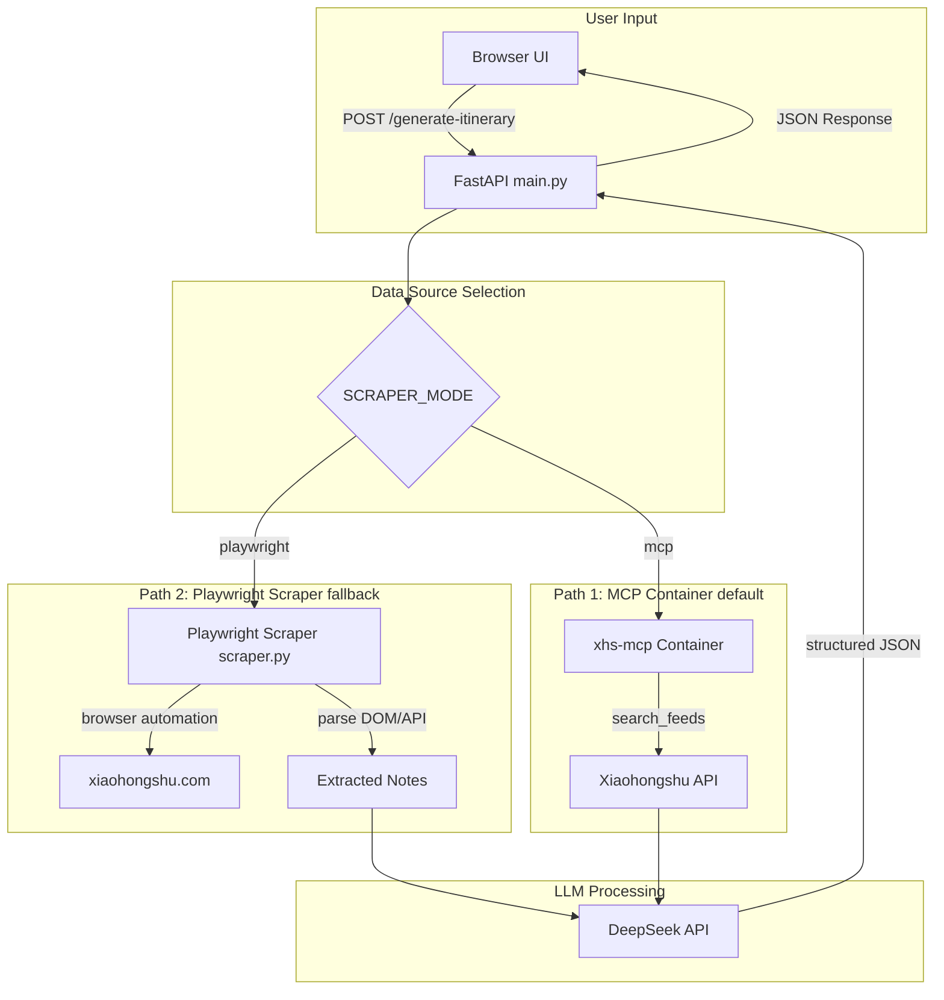

# XHS Scraper + LLM — Feasibility Analysis & Implementation Plan

## 1. The Core Question

> *"Can we use a scraper to scrape Xiaohongshu for results, then use an LLM to return the results?"*

**Answer: YES.** The current project already does exactly this — but through an MCP-based intermediary (`xpzouying/xiaohongshu-mcp` Docker container). The question is whether we should **add a direct scraper** as an alternative data source.

---

## 2. Feasibility Analysis of Direct Scraping

### Approach A: Direct HTTP API Scraping ⚠️ High Risk

Xiaohongshu's internal APIs (at `edith.xiaohongshu.com`) are heavily protected:

| Protection | Description |
|-----------|-------------|
| **X-S / X-T Signatures** | Cryptographic request signatures generated client-side (similar to Douyin/TikTok). These change frequently with app updates. |
| **Cookie Requirements** | Requires `a1`, `web_session`, `webId` and other cookies that expire quickly |
| **User-Agent Validation** | Blocks non-browser User-Agents |
| **Rate Limiting** | Aggressive rate limiting on API endpoints |
| **CAPTCHA** | May trigger CAPTCHA challenges on suspicious activity |

**Verdict:** Possible but extremely fragile. Requires constant maintenance as XHS updates their signing algorithm. **Not recommended.**

### Approach B: Browser Automation (Playwright) ✅ Feasible

Use Playwright to automate a real Chromium browser:

| Pros | Cons |
|------|------|
| No reverse-engineering of signatures | Slower startup (browser launch) |
| Handles JS rendering automatically | More resource-intensive (browser process) |
| More resilient to API changes | Requires Playwright + browser binary install |
| Can extract DOM data reliably | Slightly more complex setup |

**Verdict:** Feasible and more robust than direct API scraping. Reasonable approach.

### Approach C: Existing MCP Container (Current) ✅ Already Working

The `xpzouying/xiaohongshu-mcp` Docker container:

| Pros | Cons |
|------|------|
| Handles all XHS complexity internally | Requires Docker |
| Maintained by xpzouying community | Requires cookie setup |
| Robust with built-in retry logic | Adds container dependency |
| Clean separation of concerns | One more service to manage |

**Verdict:** Already proven and working. The MCP container IS the scraper.

### Approach D: Community XHS Python Libraries ⚠️ Mixed

Libraries like `xhs`, `PyXHS`, etc. exist but:

- Often break when XHS updates their API
- Many are unmaintained or abandoned
- Have unclear licensing
- Some are malware risks

**Verdict:** Not recommended for production.

---

## 3. Recommended Approach

**Primary Recommendation:** Keep the current MCP-based approach as the primary data source, since it's already robust and working.

**Add Playwright-based scraper as a FALLBACK** when the MCP container is unavailable. This gives us:
- The best of both worlds: production-grade MCP path + standalone fallback
- Zero extra Docker dependencies for the fallback
- Configurable via environment variable (`XHS_SCRAPER_MODE=mcp|playwright`)

---

## 4. Architecture Diagram

---

## 5. Implementation Plan

### Phase 1: Create `scraper.py` — Playwright-based scraper module

New file containing:
- `XHSScraper` class with browser lifecycle management
- `search_notes(destination: str) -> list[dict]` method
- Cookie/session management from `.env`
- Headless mode support
- Proper error handling and timeouts
- Extracts: title, description, images, likes count, author

**Dependencies to add:** `playwright`

### Phase 2: Update `main.py` — Integrate scraper

- Add `XHS_SCRAPER_MODE` env var (values: `mcp`, `playwright`)
- Modify `fetch_xhs_notes()` to dispatch to either MCP client or Playwright scraper
- Keep MCP as default, add scraper config check
- Graceful fallback if one mode fails

### Phase 3: Update `requirements.txt`

- Add `playwright>=1.40.0`

### Phase 4: Update `.env.example`

- Document `XHS_SCRAPER_MODE=mcp|playwright`

### Phase 5: Update tests

- Add test module `tests/test_scraper.py`
- Mock browser responses for deterministic tests
- Update `test_main.py` to test both modes

### Phase 6: Documentation

- Update `README.md` with scraper mode instructions
- Note Playwright installation: `playwright install chromium`

---

## 6. Files to Modify/Create

| File | Action | Purpose |
|------|--------|---------|
| `scraper.py` | **Create** | Playwright-based XHS scraper class |
| `main.py` | **Modify** | Add scraper mode dispatch |
| `requirements.txt` | **Modify** | Add `playwright` dependency |
| `.env.example` | **Modify** | Document `XHS_SCRAPER_MODE` |
| `tests/test_scraper.py` | **Create** | Scraper unit tests |
| `tests/test_main.py` | **Modify** | Test both scraper modes |
| `README.md` | **Modify** | Document Playwright setup |
| `plans/feasibility-plan.md` | **Create** | This document |

---

## 7. Potential Issues & Mitigations

| Issue | Mitigation |
|-------|-----------|
| Playwright requires browser binary install | Add `playwright install chromium` to setup docs; could add Dockerfile step |
| Headless browser may be detected | Use stealth plugins or non-headless mode with xvfb |
| XHS rate-limits browser sessions | Add random delays between requests |
| Cookie expiry | Log warning when cookie fails; fall back to MCP mode |
| Playwright startup latency (~2-3s) | Acceptable for 1 request at a time; not a hot path |
| Windows compatibility | Playwright works on Windows; install chromium via `playwright.cmd install chromium` |
