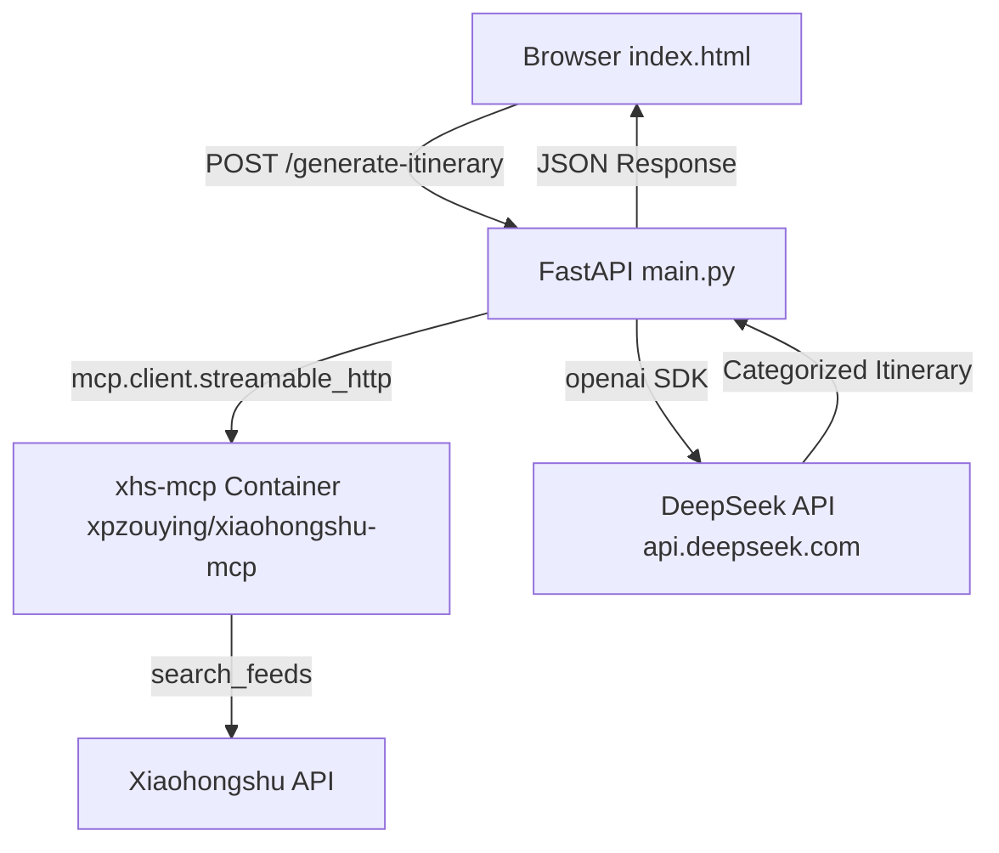

# XHS Travel Planner — Full-Stack Implementation Plan

## Architecture Overview



**Key Decision**: The FastAPI backend uses the [`mcp`](https://pypi.org/project/mcp/) Python client library to connect to the `xpzouying/xiaohongshu-mcp` Docker container via **Streamable HTTP** transport. The xhs-mcp container runs as a persistent service in docker-compose, exposing MCP tools over HTTP at `/mcp`.

---

## Data Flow

1. User enters **destination** (e.g., "Japan") and **duration** (e.g., 3 days) in the UI
2. FastAPI connects to the `xhs-mcp` service at `http://xhs-mcp:18060/mcp` via Streamable HTTP
3. Python MCP client calls the `search_feeds` tool with the destination keyword
4. Raw Xiaohongshu notes are returned as structured content
5. FastAPI sends the raw data + itinerary prompt to **DeepSeek chat API**
6. DeepSeek returns a JSON itinerary split into **Viral Hits** and **Fresh Finds**
7. FastAPI returns the structured response to the frontend
8. Frontend renders both categories

---

## Project Structure

```
c:/xhs-itinerary-planner/         # Working directory
├── .env                          # DEEPSEEK_API_KEY + XHS_COOKIE
├── .env.example                  # Template for env vars
├── .gitignore
├── .mise.toml                    # Tool versions
├── docker-compose.yml            # API service + xhs-mcp
├── Dockerfile                    # Python 3.11
├── main.py                       # FastAPI + MCP client + DeepSeek
├── requirements.txt              # Python dependencies
├── README.md                     # Setup instructions (updated)
├── static/
│   └── index.html                # Tailwind UI
├── tests/
│   └── test_main.py              # TDD test suite
└── plans/
    └── implementation-plan.md    # This file
```

---

## Component Details

### 1. Frontend — [`static/index.html`](static/index.html)

**UI Elements:**
- Header with app title and description
- Input form: destination text field, days number input, generate button
- Loading state with spinner animation
- Results section split into two columns:
  - **Viral Hits** — Popular/recommended spots from Xiaohongshu
  - **Fresh Finds** — Hidden gems and lesser-known places
- Error state display

**Technical Decisions:**
- Tailwind CSS loaded via CDN (no build step)
- Vanilla JavaScript using `fetch` + `async/await`
- Clean responsive layout with Tailwind utility classes
- No framework overhead

### 2. Backend — [`main.py`](main.py)

**Endpoints:**

| Method | Path | Description |
|--------|------|-------------|
| `GET` | `/` | Serves `static/index.html` |
| `POST` | `/generate-itinerary` | Accepts `{destination: str, days: int}`, returns itinerary JSON |

**Request/Response Schema:**

```python
# Request
class TravelRequest(BaseModel):
    destination: str
    days: int = Field(ge=1, le=30)

# Response
class ItineraryResponse(BaseModel):
    destination: str
    days: int
    viral_hits: list[Activity]
    fresh_finds: list[Activity]

class Activity(BaseModel):
    name: str
    description: str
    category: str       # e.g., "food", "sightseeing", "shopping"
    estimated_hours: float
```

**Core Functions:**

```python
async def fetch_xhs_notes(destination: str) -> list[dict]:
    """Connect to xiaohongshu-mcp via Streamable HTTP and search for notes."""
    async with streamable_http_client(XHS_MCP_URL) as (read, write, _get_session_id):
        async with ClientSession(read, write) as session:
            await session.initialize()
            result = await session.call_tool(
                "search_feeds",
                arguments={
                    "keyword": destination,
                    "filters": {"sort_by": "最新", "note_type": "图文"},
                },
            )
            return parse_mcp_content(result)

async def generate_itinerary(raw_notes: list[dict], destination: str, days: int) -> dict:
    """Send raw XHS data to DeepSeek for structured itinerary generation."""
    response = await openai_client.chat.completions.create(
        model="deepseek-chat",
        messages=[
            {"role": "system", "content": SYSTEM_PROMPT},
            {"role": "user", "content": format_prompt(raw_notes, destination, days)}
        ],
        response_format={"type": "json_object"}
    )
    return json.loads(response.choices[0].message.content)
```

### 3. MCP Integration

**Python MCP Client Approach (Streamable HTTP):**
- Uses the official `mcp` PyPI package with `mcp.client.streamable_http.streamable_http_client`
- Connects to the persistent `xhs-mcp` container via HTTP at `http://xhs-mcp:18060/mcp`
- The `xhs-mcp` service runs as a long-lived Docker container managed by docker-compose
- `XHS_COOKIE` is passed as an environment variable to the xhs-mcp container
- `XHS_MCP_URL` configures the endpoint (default: `http://localhost:18060/mcp`)

**Why Streamable HTTP instead of stdio?**
- The `xpzouying/xiaohongshu-mcp` Docker image uses Go MCP SDK with `mcp.NewStreamableHTTPHandler` — it only supports HTTP transport
- Streamable HTTP is a standard MCP transport that allows persistent connections
- No need to spawn a new container per request (faster response times)
- Clean separation of concerns: xhs-mcp is a data service, API is a separate service

### 4. DeepSeek Integration

**API Details:**
- Endpoint: `https://api.deepseek.com/v1/chat/completions`
- Model: `deepseek-chat` (DeepSeek-V3)
- Authentication: Bearer token via `DEEPSEEK_API_KEY`
- Uses `openai` Python SDK with custom base URL
- `response_format: json_object` ensures structured output

**Prompt Design:**

The system prompt instructs DeepSeek to:
1. Review all Xiaohongshu notes for the destination
2. Categorize into **Viral Hits** (highly recommended/repeatedly mentioned popular spots) and **Fresh Finds** (unique, lesser-known places)
3. Organize into a day-by-day itinerary based on `days` parameter
4. Include practical details: estimated time, category, brief description
5. Return only valid JSON matching the expected schema

### 5. Infrastructure

**Dockerfile:**
```dockerfile
FROM python:3.11-slim
WORKDIR /app
COPY requirements.txt .
RUN pip install --no-cache-dir -r requirements.txt
COPY . .
CMD ["uvicorn", "main:app", "--host", "0.0.0.0", "--port", "8000"]
```

**docker-compose.yml:**
```yaml
services:
  xhs-mcp:
    image: xpzouying/xiaohongshu-mcp:v1.1.2
    ports:
      - "18060:18060"
    env_file:
      - .env
    environment:
      XHS_COOKIE: ${XHS_COOKIE}

  api:
    build: .
    ports:
      - "8000:8000"
    env_file:
      - .env
    environment:
      XHS_MCP_URL: http://xhs-mcp:18060/mcp
    depends_on:
      - xhs-mcp
```

**requirements.txt:**
```
fastapi==0.115.0
uvicorn[standard]==0.30.0
mcp==1.0.0
openai==1.50.0
pydantic==2.9.0
pytest==8.3.0
httpx==0.27.0
python-dotenv==1.0.0
```

### 6. TDD Test Suite — [`tests/test_main.py`](tests/test_main.py)

**Red Phase (write failing tests first):**
- `test_generate_itinerary_structure` — POST with valid data, expect 200 + JSON with `viral_hits` + `fresh_finds`
- `test_generate_itinerary_invalid_days` — POST with days=0 or days=31, expect 422 validation error
- `test_generate_itinerary_missing_destination` — POST without destination, expect 422
- `test_root_serves_html` — GET `/` returns 200 with content-type text/html

**Green Phase (minimal implementation):**
- Stub `fetch_xhs_notes` to return mock data
- Stub DeepSeek call to return hardcoded itinerary JSON
- Tests pass with mocks

**Refactor Phase (real integration):**
- Implement actual MCP client connection via Streamable HTTP
- Implement actual DeepSeek API call
- Tests use `httpx` mock fixtures for external services
- Verify with `pytest --cov`

---

## Implementation Order (TDD Steps)

### Phase 1: Scaffolding
1. Initialize project structure and config files
2. Create `.mise.toml`, `requirements.txt`, `Dockerfile`, `docker-compose.yml`, `.env.example`, `.gitignore`

### Phase 2: Red — Write Failing Tests
3. Create `tests/test_main.py` with the 4 test cases above
4. Run tests — they should fail (no `main.py`)

### Phase 3: Green — Minimal Backend
5. Create `main.py` with the `/generate-itinerary` endpoint returning hardcoded mock data
6. Create `static/index.html` with the Tailwind UI
7. Run tests — they should pass

### Phase 4: Refactor — Real Integration
8. Install `mcp` Python client and `openai` SDK
9. Implement `fetch_xhs_notes()` using `mcp.client.streamable_http`
10. Implement DeepSeek API call using `openai` SDK
11. Wire everything together in the `/generate-itinerary` endpoint
12. Update tests with proper mocks for external services

### Phase 5: Polish
13. Add error handling and edge cases
14. Update README.md with setup instructions
15. Test end-to-end: `docker-compose up --build` + browser test

---

## Design Considerations & Potential Issues

1. **Windows Docker socket**: The `/var/run/docker.sock` bind mount works on Windows Docker Desktop because it runs in a WSL2/Hyper-V VM with a Linux filesystem. This is the standard approach.

2. **MCP package version**: The `mcp==1.0.0` version may need adjustment if the package has been updated. Verify during implementation.

3. **XHS_COOKIE**: Users must obtain their own Xiaohongshu cookie for the MCP container to work. Document this clearly in README.

4. **Streamable HTTP vs stdio**: The xiaohongshu-mcp Docker image v1.1.2 uses Go MCP SDK with `NewStreamableHTTPHandler`, meaning it **only supports HTTP transport**. The Python client uses `streamable_http_client` to connect.

5. **Timeout handling**: DeepSeek API calls and MCP container startup should have appropriate timeouts configured.
